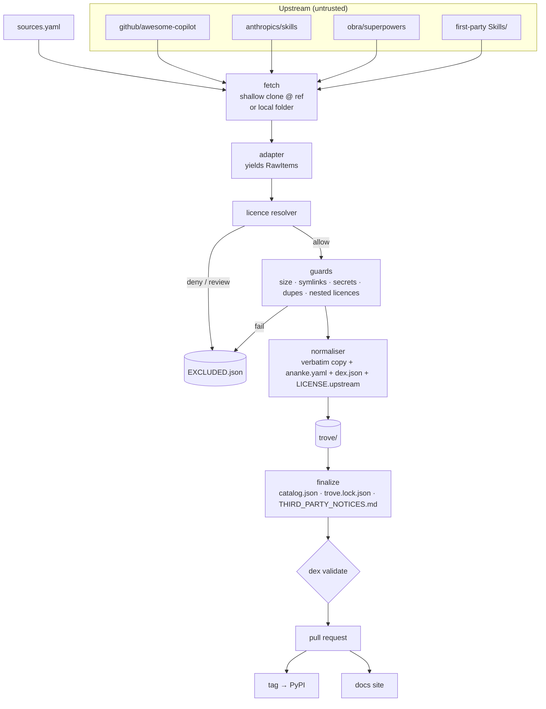
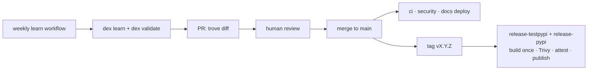

# Architecture

Dex Trove has four parts: a **learn pipeline** that turns upstream repos into normalised items, the **trove**
(the checked-in library), the **`dex-trove` package** that ships it, and the **docs site** generated from it.



## 1. Sources and adapters

A **source** is an entry in [`sources.yaml`](../reference/sources-yaml.md): an id (which becomes the item
namespace), a repo URL and ref, or a local folder, an adapter, and optional exclusions and per-item overrides.

`dex_trove.sources.fetch` materialises a source:

- **repo**: a shallow clone (`git clone --depth 1 --branch <ref>`) into `~/.cache/dex-trove/sources/<id>`, then
  `git fetch --depth 1` + `reset --hard FETCH_HEAD` on later runs. The resulting commit SHA is recorded.
- **local**: used directly (first-party folders, or `--prefer-local` for a checkout you already have). The commit
  is recorded if the folder is a git repo, otherwise `null`.

An **adapter** knows one upstream layout and yields `RawItem`s: kind, raw name, path, entry file, parsed
frontmatter, description, tags, upstream version, author and (for plugins) member references. Adapters only
*find* things; they never decide admission.

| Adapter | Recognises |
| --- | --- |
| `agent-skills` | any directory with a `SKILL.md` under `options.roots` ([Agent Skills spec](https://agentskills.io/specification)) |
| `awesome-copilot` | `skills/*/`, `agents/*.agent.md`, `instructions/*.instructions.md`, `prompts/*.prompt.md`, `hooks/*/` (README + `hooks.json`), `workflows/*.md`, `plugins/*/plugin.json` |
| `md-agents` | Markdown files with `name`/`description` frontmatter matching `options.globs` |

## 2. The learn pipeline

Before anything else, items matching the source's `.dexignore` (in the source root) or the user-level ignore file
are skipped silently. They are never copied or recorded, so private items leave no trace in the repo.

For each remaining `RawItem`, `dex_trove.learn.Learner` runs these steps in order. The first failure excludes the item and
records the reason ([exclusion reasons](../reference/exclusion-reasons.md)).

1. **Name.** Slugify (`CSharpExpert` → `csharp-expert`), validate against Ananke's name rule (lower-kebab, ≤ 64),
   reject collisions within the namespace.
2. **Licence.** Resolve from the most specific evidence outwards
   ([licence policy](licence-policy.md)). Anything other than *allow* excludes the item.
3. **Collect files.** Walk the item directory, skipping junk (`.DS_Store`, `__pycache__`, `*.pyc`,
   `node_modules`), symlinks (recorded as notes) and `sources.yaml` `exclude` globs (counted in notes).
4. **Entry check.** The entry file (`SKILL.md`, `x.agent.md`, …) must survive collection.
5. **Size.** ≤ 5 MB per file, ≤ 20 MB per item.
6. **Nested licences.** Licence files inside the item (bundled fonts, vendored code) are classified. A denied one
   excludes the whole item; allowed ones are recorded as `license.components`.
7. **Real credentials.** Real-format keys and tokens exclude the item.
8. **Duplicates.** If the entry file is byte-identical to one already learned from a higher-priority source,
   the item is excluded as a duplicate.
9. **Normalise.** Compute file hashes and the content hash, pick the item version, tag executable content and
   Ananke secret flags, write the item directory.

Plugins are processed **after** the other items of their source, so their members can be resolved against what
was actually admitted. Members that were excluded are dropped; a plugin with no admissible members is excluded.

When a source finishes, any item directory of that namespace that was *not* produced this run is removed: the
item vanished upstream or is now excluded. A source that fails to fetch is skipped and its items are left
untouched.

## 3. The trove

```text
trove/
├── skills/<ns>.<name>/        SKILL.md + bundled files (verbatim) + ananke.yaml + dex.json [+ LICENSE.upstream, NOTICE.upstream]
├── agents/<ns>.<name>/        <file>.agent.md + generated files
├── instructions/ prompts/ hooks/ workflows/ plugins/
├── catalog.json               every item's dex.json, sorted (drives the CLI and the site)
├── EXCLUDED.json              every refused candidate with reason and detail
└── trove.lock.json            per source: repo, ref, commit, learned_at, counts
```

The directory naming is deliberate. Ananke's Python importer looks for manifests at most **four path parts deep**
inside an installed wheel. `dex_trove/skills/<ns.name>/ananke.yaml` is exactly four, while a nested
`<ns>/<name>` would be five and invisible. The flat `<namespace>.<name>` form also mirrors Ananke's own installed
layout (`<namespace>.<name>@<version>`).

See [item format](../reference/item-format.md) and [trove files](../reference/trove-files.md).

## 4. The package

`dex-trove` is a hatchling package. A small build hook (`hatch_build.py`) force-includes each `trove/<kind>/`
directory and the trove JSON files into the wheel as package data under `dex_trove/`:

```text
dex_trove/
├── cli.py learn.py licenses.py …     the code
├── skills/<ns.name>/ananke.yaml …    the library (970 manifests at depth 4)
├── catalog.json EXCLUDED.json trove.lock.json sources.yaml
└── license_texts/Apache-2.0.txt      canonical texts used when upstream only declares a licence
```

At runtime, `dex_trove.paths.trove_root()` finds the library in this order: `$DEX_TROVE_ROOT`, the installed
package (if it contains `catalog.json`), then `./trove` in a Dex-Trove checkout. The CLI works the same in an
installed wheel and in a development checkout.

The wheel declares an entry point `ananke.troves: dex-trove = dex_trove.paths:trove_root`, so any harness can
locate a trove generically.

## 5. Consumers

| Consumer | Mechanism |
| --- | --- |
| **Ananke** | `ananke registry learn python:dex-trove` reads the `ananke.yaml` manifests from the installed wheel; `dex ananke sync` offers a filtered set through the `ananke` CLI |
| **Claude Code** | `dex install … --target claude` copies skills to `skills/<name>/`, agents to `agents/<name>.md`, prompts to `commands/<name>.md` under `~/.claude` or `./.claude` |
| **GitHub Copilot** | `dex install … --target copilot` writes the `.github/` layout (skills, agents, instructions, prompts, hooks, workflows) |
| **Anything else** | `dex install … --target dir --path P` copies the full normalised item |
| **This site** | `dex docs export` writes one Markdown page per item and JSON indexes; Astro renders them |

## 6. The docs site

`website/` is an Astro static site, the same stack as VICHARA. Content is generated at build time, so the site
cannot drift from the trove:

- `dex docs export --out website/src` writes `src/content/items/*.md` (frontmatter = catalog record + upstream
  metadata, file list, hook events, related items; body = sanitised upstream Markdown) and `src/data/*.json`.
- The documentation you are reading is loaded directly from `docs/`.
- Relative links and images in upstream Markdown are rewritten to the upstream repo, pinned to the learned commit.

See [Docs site](../guides/docs-site.md).

## 7. Delivery loop



See [Release](../guides/release.md).
