# Artifact kinds

Dex Trove has seven kinds of artifact. They all look like "a Markdown file with frontmatter", but a harness treats
them very differently: some are always in the model's context, some are loaded only when the model decides they're
relevant, some only when you type a command, and some run without the model being involved at all. Knowing which is
which tells you what an item will cost, when it will act, and what it is allowed to do.

This page explains each kind and follows an item all the way from its upstream repository, through Dex Trove, into
the harness that runs it. To choose between kinds, see [Which artifact when](which-artifact-when.md).

## At a glance

| Kind | What it is | Loaded when | Who decides | Runs code? | In the trove |
| --- | --- | --- | --- | --- | --- |
| [skill](#skill) | a folder of know-how and helpers | the task matches its description | the model | if it bundles scripts (62 do) | 472 |
| [agent](#agent) | a persona with its own instructions and tools | you pick it, or another agent delegates | you or a parent agent | through its tools | 220 |
| [instruction](#instruction) | standing rules for matching files | always, for files matching `applyTo` | the harness | no | 189 |
| [prompt](#prompt) | a reusable request | you type the command | you | no | 0 |
| [hook](#hook) | a command bound to a session event | the event fires | the harness | **always** | 7 |
| [workflow](#workflow) | an agentic automation in CI | its trigger fires (schedule, issue, PR…) | the trigger | in CI, under declared permissions | 8 |
| [plugin](#plugin) | a bundle of the above | when installed (its members then behave as above) | you | as its members | 72 |

Counts are for the current trove (968 items). The live numbers are on the [catalog](https://neo-pragnya.github.io/Dex-Trove/catalog/).

## The whole journey

Every item takes the same path. Dex Trove never edits upstream files; it adds evidence beside them.

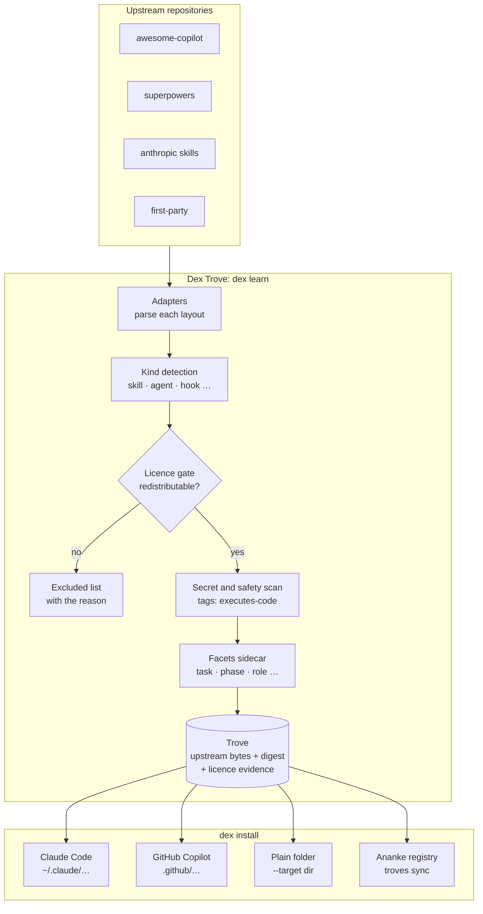

1. **Learn.** An adapter per source reads the upstream layout and decides each file's kind.
2. **Admit.** Only items whose licence permits redistribution go into the trove. Every exclusion is listed with
   its reason on the [excluded page](https://neo-pragnya.github.io/Dex-Trove/excluded/).
3. **Annotate.** Dex scans for secret-shaped strings and code that runs. It also records facets (task, methodology,
   phase, role and more) in a sidecar, without touching the upstream file.
4. **Install.** `dex install` writes the item into the native layout of the tool you choose. When the tool needs
   it, Dex adapts metadata; for example, it translates Copilot agent `tools` into names Claude Code understands.

## What happens inside a harness

Once installed, kinds act at different moments of an agent session. This is the core idea of this page:

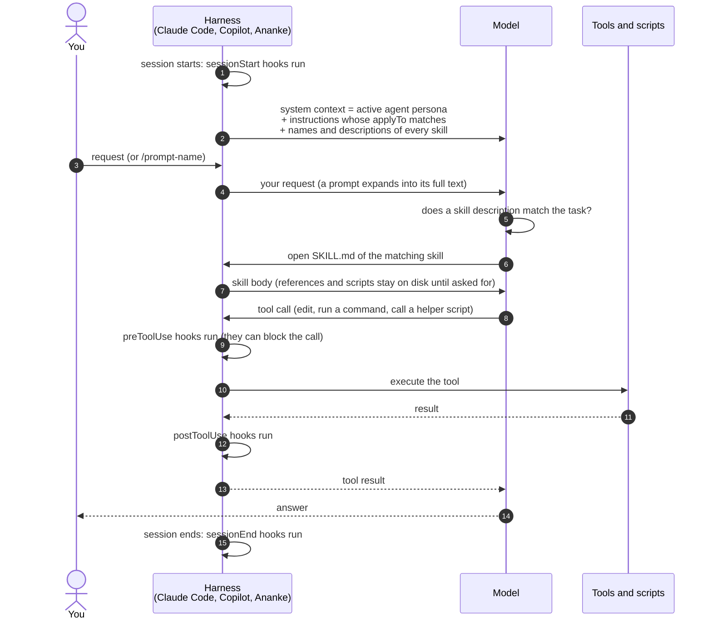

Read it as three layers:

- **Always in context** (pay every turn): the active **agent** persona and matching **instructions**. Keep these
  short.
- **In context on demand** (pay only when used): **skills**. Before use, only a skill's name and description sit in
  context. Its body, references and scripts load progressively, so a hundred skills cost little until one is used.
- **Outside the model**: **hooks** run on events and never ask the model. **Workflows** run in CI on triggers.
  **Prompts** are expanded by the harness when you type them.

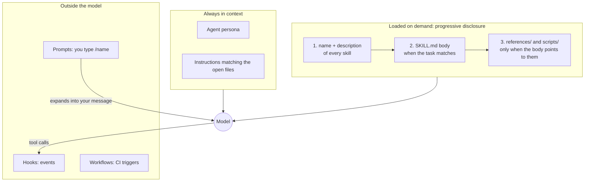

## How kinds compose

Kinds are building blocks that refer to each other:

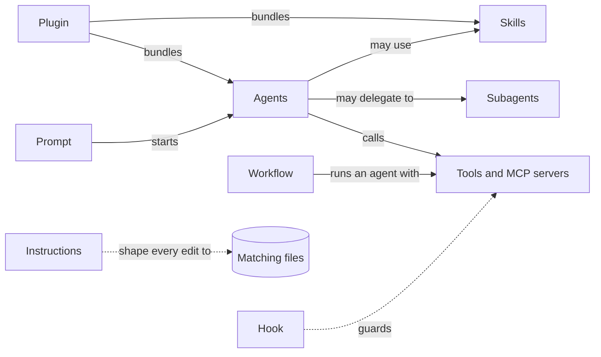

- A **plugin** is only packaging: installing it installs each member.
- An **agent** decides *how to behave*. A **skill** gives *know-how for one kind of task*. A good agent stays
  general and leans on skills.
- **Hooks** and **instructions** constrain everything else: hooks around tool calls and session events,
  instructions around the files being edited.

## Skill

A **skill** is a folder of instructions plus bundled resources (scripts, references, templates, assets) that an
agent loads *on demand* when the task matches its description. It follows the
[Agent Skills specification](https://agentskills.io/specification):

```text
my-skill/
├── SKILL.md          frontmatter: name, description (+ license, allowed-tools, compatibility, metadata…)
├── references/       docs the agent reads only when needed
├── scripts/          deterministic helpers the agent runs
└── assets/           templates, examples, images
```

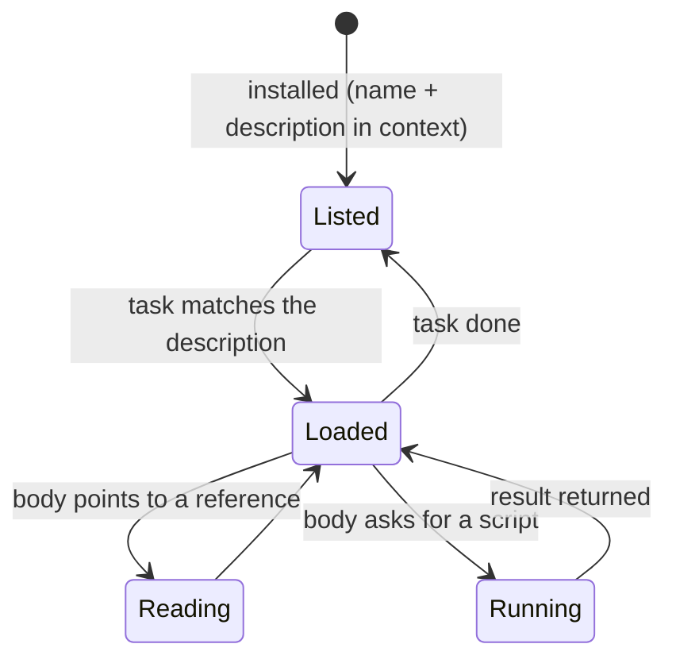

- **Trigger:** the `description`. The harness shows the model only names and descriptions, and the model opens
  `SKILL.md` when one matches. A good description says *what* the skill does and *when* to use it, including the
  words people actually type.
- **Context cost:** about one line per installed skill until it is used.
- **Safety:** 62 skills bundle scripts. These are tagged `executes-code` and show **runs code** on their page. Read
  the scripts before you let an agent run them. `allowed-tools` in the frontmatter narrows what the skill may use,
  where the harness supports it.
- **Claude Code:** `dex install <ref> --target claude` → `~/.claude/skills/<name>/` (user) or
  `./.claude/skills/<name>/` (`--scope project`). Claude Code discovers skills there automatically.
- **Copilot:** `--target copilot` → `.github/skills/<name>/`.
- **Ananke:** kind `skill`; activate after learning (see [In Ananke Plexus](#in-ananke-plexus)).

## Agent

An **agent** (custom agent, subagent or "chat mode") is a persona with its own system instructions and,
optionally, a tool allow-list, a preferred model and MCP servers. Upstream frontmatter commonly includes:

| Key | Meaning |
| --- | --- |
| `name`, `description` | identity and when to use it |
| `tools` | tools the agent may use (e.g. `codebase`, `editFiles`, `runCommands`) |
| `model` | preferred model |
| `mcp-servers` | MCP servers the agent expects |
| `argument-hint`, `user-invocable`, `handoffs` | invocation details |

The item page shows all of these under **Upstream metadata**.

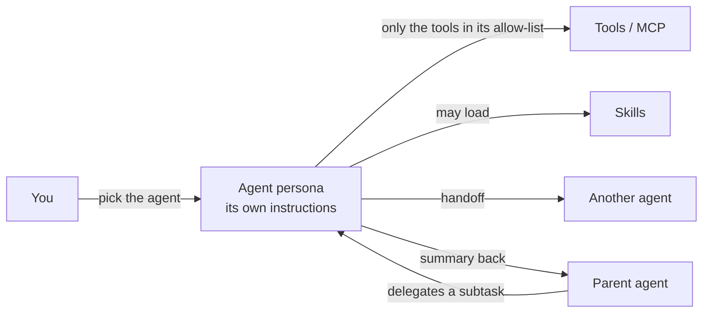

- **Trigger:** you select it, or a parent agent delegates to it as a *subagent*, which gets its own fresh context
  and returns a summary.
- **Context cost:** its whole body, for as long as it is active. In a subagent this cost stays out of the parent's
  context.
- **Safety:** what it can do is bounded by its `tools`. An agent without `runCommands` can't run a shell.
- **Claude Code:** `agents/<name>.md` (a subagent). `dex install` translates Copilot `tools` and `model` values into
  ones Claude Code can launch; see [Agents in Claude Code](../guides/installing-items.md#agents-in-claude-code).
- **Copilot:** `.github/agents/<name>.agent.md`.
- **Ananke:** kind `agent`; the manifest's `instructions.ref` points at the entry file.

## Instruction

An **instruction** file holds coding standards that the harness applies automatically to files matching its
`applyTo` glob (e.g. `'**/*.py'`). Item pages show the glob.

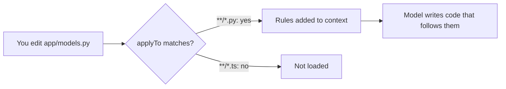

- **Trigger:** the harness, by file glob. The model doesn't choose.
- **Context cost:** the whole file, every time a matching file is involved. Keep instructions short and specific.
- **Safety:** text only; nothing runs.
- **Copilot:** `.github/instructions/<name>.instructions.md`.
- **Claude Code:** no native equivalent. Install with `--target dir` and reference the file from `CLAUDE.md`, or
  turn it into a skill.
- **Ananke:** kind `prompt`, tag `instruction`.

## Prompt

A reusable prompt file (`*.prompt.md`), invoked explicitly by the user. The current sources ship none, but the
`awesome-copilot` adapter supports them.

- **Trigger:** you, by name (`/name`). The harness expands it into your message.
- **Context cost:** only when you use it.
- **Claude Code:** `commands/<name>.md` (a slash command).
- **Copilot:** `.github/prompts/<name>.prompt.md`.

## Hook

A **hook** runs a command automatically when an agent session event fires (`sessionStart`, `sessionEnd`,
`preToolUse`, …). It is a folder with a `README.md` (frontmatter `name`, `description`, `tags`), a `hooks.json`
and usually a script:

```json
{
  "version": 1,
  "hooks": {
    "sessionEnd": [
      { "type": "command", "bash": ".github/hooks/secrets-scanner/scan-secrets.sh", "timeoutSec": 30 }
    ]
  }
}
```

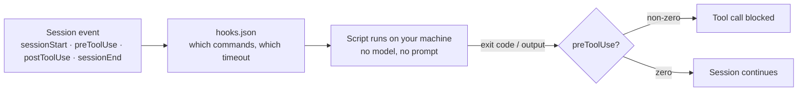

- **Trigger:** the event. No model is involved and nobody is asked.
- **Context cost:** none, unless the hook's output is fed back.
- **Safety:** hooks **run code without asking**, so Dex never installs one unless you pass `--allow-exec`. Read
  the script first. Item pages list each event with its command and timeout.
- **Copilot:** `.github/hooks/<name>/` (with `--allow-exec`).
- **Ananke:** kind `tool`, tags `hook` and `executes-code`.

## Workflow

An **agentic workflow** ([GitHub Agentic Workflows](https://github.github.com/gh-aw)) is a Markdown file whose
frontmatter declares triggers (`on`), `permissions`, `safe-outputs`, `tools` and `engine`, and whose body
is natural-language instructions. Item pages show the triggers and permissions.

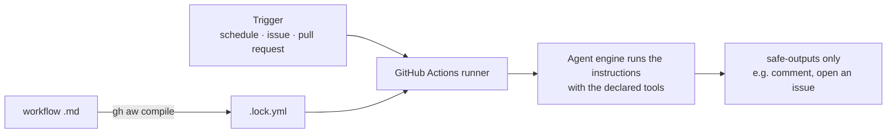

- **Trigger:** an event in your repository, not a chat. It runs unattended.
- **Safety:** bounded by `permissions` and `safe-outputs`. Check both before enabling a workflow.
- **Copilot / GitHub:** `.github/workflows/<name>.md`, then compile with the `gh aw` CLI.
- **Ananke:** kind `workflow`.

## Plugin

A **plugin** groups related skills and agents around a theme (e.g. `arize-ax` bundles 9 Arize skills). Upstream
it is a `plugin.json` ([Agent Plugins](https://agent-plugins.org/schemas/1.0.0/plugin.schema.json)) whose
`extensions.com.github.awesome-copilot` lists `skills` and `agents`.

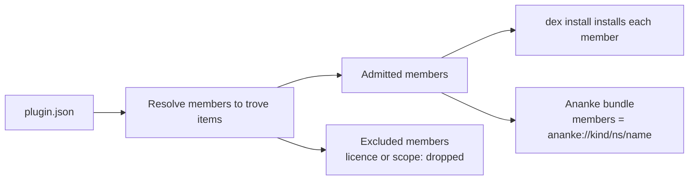

In Dex a plugin keeps its `plugin.json` and `README.md`, and its members are resolved to trove items:

- `dex install <plugin>` installs every member into the target.
- In Ananke the plugin becomes a **bundle** whose `members` are `ananke://<kind>/<ns>/<name>` references.
  `ananke registry resolve <ns>/<plugin> --explain` shows the member graph.
- Members excluded for licence or other reasons are dropped. A plugin with no admissible members, such as
  awesome-copilot's canvas-only plugins, is excluded as `out-of-scope`.

## Where each kind lands

| Kind | Upstream shape | Claude Code | GitHub Copilot | Ananke kind |
| --- | --- | --- | --- | --- |
| skill | folder with `SKILL.md` | `skills/<name>/` | `.github/skills/<name>/` | `skill` |
| agent | `*.agent.md` or frontmatter `.md` | `agents/<name>.md` | `.github/agents/<name>.agent.md` | `agent` |
| instruction | `*.instructions.md` with `applyTo` | — | `.github/instructions/` | `prompt` |
| prompt | `*.prompt.md` | `commands/<name>.md` | `.github/prompts/` | `prompt` |
| hook | folder with `README.md` + `hooks.json` | — | `.github/hooks/<name>/` | `tool` |
| workflow | agentic workflow `.md` | — | `.github/workflows/<name>.md` | `workflow` |
| plugin | `plugin.json` listing members | members | members | `bundle` |

"—" means the tool has no native equivalent; use `--target dir` and wire it up yourself.

## In Ananke Plexus

[Ananke Plexus](https://neo-pragnya.github.io/Ananke-Plexus/) treats every kind as a **versioned capability** in a
registry, not as loose files. Dex Trove is one of its sources:

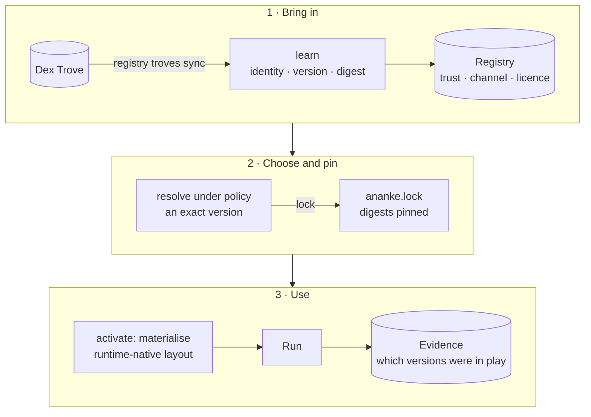

- `ananke registry troves enable dex-trove` then `ananke registry troves sync` learns the slice you choose.
  Items flagged for secrets are skipped.
- `ananke registry resolve` picks an exact version under your policy (trust, channel, licence). `lock` pins it
  in `ananke.lock`, and `verify-lock` checks the digests later.
- `ananke registry activate` materialises the version for your project. `translate` shows the runtime-native
  file it will produce.
- Every run records which capability versions were in play, so a result can be traced back to the exact skill
  text that shaped it.

See [Using Dex Trove with Ananke](../guides/ananke-integration.md) for the commands in order.

## Safety by kind

| Kind | Can run code | Dex default | What to check before use |
| --- | --- | --- | --- |
| skill | only through bundled scripts | installs; flags `executes-code` | the scripts, and `allowed-tools` |
| agent | through its tools | installs; adapts tool names | `tools` and `mcp-servers` |
| instruction | no | installs | that the glob is narrow enough |
| prompt | no | installs | nothing special |
| hook | **yes, automatically** | **refused without `--allow-exec`** | the script, every event it binds |
| workflow | yes, in CI | installs | `permissions` and `safe-outputs` |
| plugin | as its members | installs admitted members | each member, as above |

See the [security model](security-model.md) and [licence policy](licence-policy.md) for how these defaults are
enforced.
