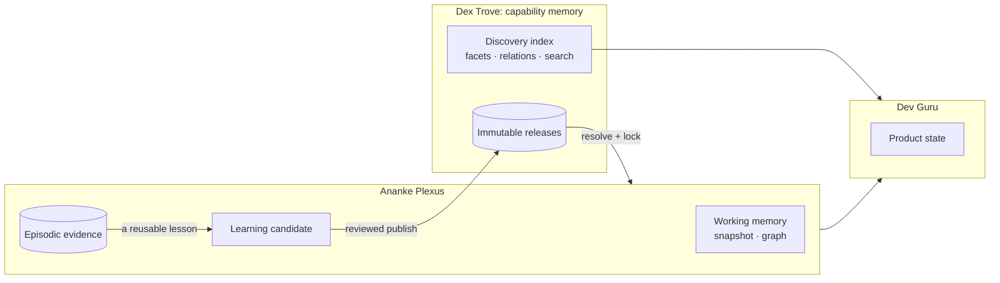
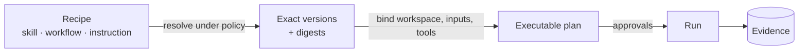
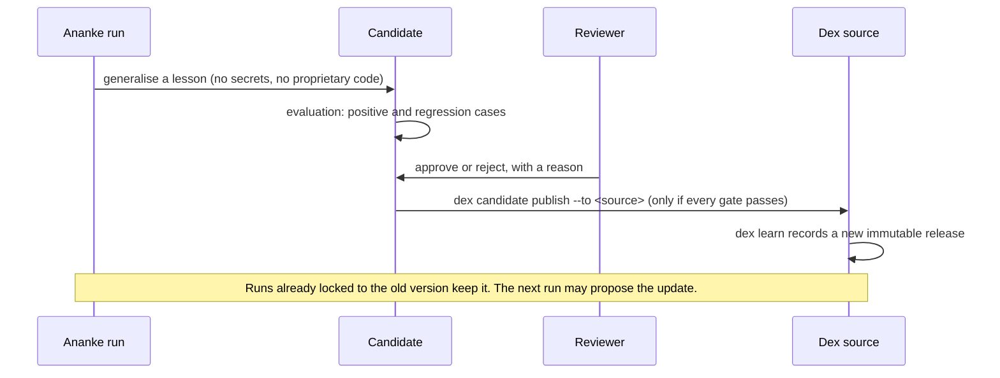

# Capability memory

Dex Trove is the **capability memory** of the three-repository system (Dex Trove, [Ananke Plexus](https://neo-pragnya.github.io/Ananke-Plexus/)
and [Dev Guru](https://neo-pragnya.github.io/Dev-Guru/)). That word is easy to over-read, so this page pins it down:
what kind of memory Dex holds, what it deliberately doesn't, and how a lesson learned in one run can become
reusable know-how for every run after it.

## Five kinds of memory, three owners

| Memory | Owner | Examples | How it changes |
| --- | --- | --- | --- |
| **Capability memory**: reusable know-how | Dex Trove, or your own internal source | skills, instructions, workflows, curated relations | immutable releases, plus a discovery index that can refresh |
| **Working memory**: this workspace now | Ananke | source snapshot, code graph, retrieval cache | scoped to a workspace and revision; rebuildable |
| **Episodic evidence**: what happened in a run | Ananke | test results, approvals, failed attempts, which versions were in play | appended; retained or redacted by policy |
| **Product state**: how you like to work | Dev Guru | saved views, layout, explanation depth | local preferences you can export |
| **Learning candidates**: a lesson worth keeping | Ananke, pending review | a generalised fix strategy with evaluation cases | reviewed and evaluated before it is published |

Dex holds only the first row. It never stores your conversations, your code, run logs or approvals. Those stay with
the harness and the product, close to the workspace they describe.

## Memory versus evidence

**Memory** is how to do something: "to stabilise a flaky test, isolate time, randomness and ordering". It is
general, reviewed, licensed for reuse, and identical for everyone who installs that version.

**Evidence** is what happened: "on 2 November, test `test_checkout` failed twice, then passed after freezing the
clock". It is specific to one workspace, may contain proprietary code or data, and belongs with the run that
produced it.

Keep them apart:

- A skill never embeds a project's code, logs or secrets. The [candidate gate](provenance-and-versioning.md#reviewed-candidates-how-new-memory-gets-in)
  refuses secret-shaped text.
- A run records *which* capability versions it used (their digests), not copies of them. So evidence stays
  attributable to the exact memory that shaped it, even after that memory is updated.
- Failure evidence can improve a rubric or an evaluation case without ever becoming public content.

## Recipe versus executable plan

A **recipe** is a capability as stored in memory: a skill, workflow or instruction that says *how* to approach a
kind of task. It has no workspace, no inputs bound, and no permission to do anything.

An **executable plan** is what a harness builds for one run:

1. resolve each requirement to an exact capability version under policy (trust, channel, licence);
2. lock those versions and their digests;
3. bind the workspace, inputs and tools;
4. get any approvals the policy needs;
5. execute, and record evidence.

Dex supplies recipes and can pin them (`dex lock`, `dex ananke handoff`). It never executes them, never binds a
workspace, and never grants a permission. A skill's text can *ask* for a tool; only the harness and your policy can
*allow* it.

## How a lesson becomes memory

- **Refresh is not activation.** Updating the trove changes what *new* locks pick. A locked run never switches
  versions mid-run.
- **Rejection is final for that candidate.** A rejected or failing candidate stays in the workspace, or is deleted
  by retention policy. It can't publish.
- **Private lessons stay private.** A candidate marked `internal` can only publish into a source marked
  `visibility: internal`.
- **Rollback is a new plan**, not a rewrite. Pick an earlier release in a new lock. History is never edited.

## Dex is one source, and optional

Dex Trove is the reference source, not a requirement:

- **The catalog works without a harness.** Browsing, searching, filtering and installing need only `dex-trove`.
  Neither Ananke nor Dev Guru has to be installed.
- **The harness works without Dex.** Ananke resolves capabilities from any provider that supplies identity,
  versions and digests: your own internal source, a folder, another registry. A provider with less metadata (no
  facets, no relations) still works; it is just harder to discover.
- **No silent substitution.** If a source is unreachable, Ananke reports it. It doesn't fall back to a
  similarly named item from somewhere else.

## Why tags can't prove compatibility

Facets and relations say where an item is *relevant*: which task, which role, what it complements. They can't
prove it will *run* in your setup. That depends on its declared requirements, the tools you have and your policy,
which the harness checks at resolve time. See [Finding capabilities](../guides/finding-capabilities.md#what-facets-cant-tell-you)
and [Related items](related-items.md#never-compatible).

## See also

- [Provenance & versioning](provenance-and-versioning.md): releases, locks, yank, forks and candidates in detail.
- [Artifact kinds](artifact-kinds.md): how each kind behaves inside a harness.
- [Using Dex Trove with Ananke](../guides/ananke-integration.md).
