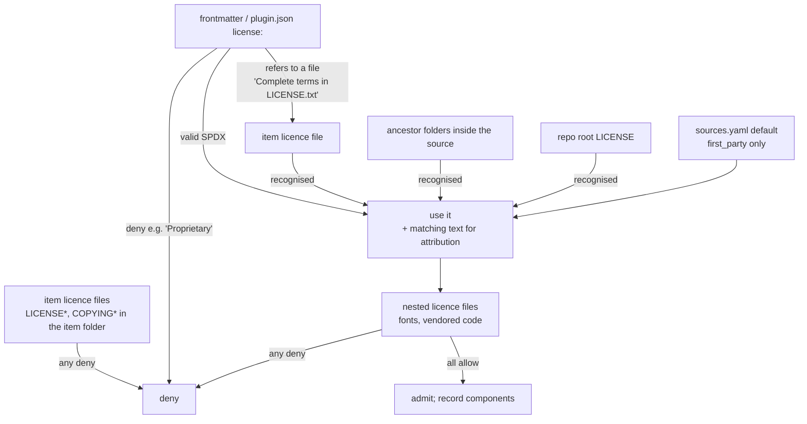

# Licence policy

Publishing a package to PyPI is **distribution**. Dex Trove therefore only ships content whose licence lets
anyone copy, redistribute and reuse it, and it carries every attribution obligation along with the content.

## Verdicts

| Verdict | SPDX ids | Behaviour |
| --- | --- | --- |
| **allow** | MIT, MIT-0, Apache-2.0, BSD-2-Clause, BSD-3-Clause, ISC, 0BSD, Unlicense, CC0-1.0, CC-BY-4.0, Zlib, BSL-1.0, Python-2.0, PSF-2.0, OFL-1.1 | Imported; notices preserved |
| **review** | MPL-\*, EPL-\*, LGPL-\*, CC-BY-SA-\* | Excluded unless the source sets `license.allow_review: true` after a human decision |
| **deny** | GPL-\*, AGPL-\*, CC-BY-NC\*, CC-BY-ND\*, SSPL, BUSL, `LicenseRef-*` (proprietary, source-available), `NOASSERTION`, unknown | Never imported |

Why these lines:

- **Permissive licences** (allow) only require attribution, which Dex provides.
- **Weak copyleft and share-alike** (review) are redistributable, but the obligations can extend to derivatives
  and modifications. That needs a human decision per source.
- **Strong copyleft** (deny) would impose its terms on the combined package. **Non-commercial or no-derivatives**
  terms forbid uses that consumers of a general library will make. **Proprietary or unknown** means no permission
  at all.
- **OFL-1.1** is allowed because it explicitly permits bundling fonts with software (it forbids only selling the
  fonts by themselves). It appears as a *component* inside items such as `anthropic/canvas-design`.

## Resolution order

For every item, Dex collects evidence from the most specific place outwards and stops at the first conclusive
answer. **Any restrictive evidence at item level wins outright.**



1. **Item licence files** (`LICENSE*`, `COPYING*`, `UNLICENSE*` directly in the item folder), classified by
   text. If any is restrictive, the item is denied.
2. **Frontmatter** `license:` (or `plugin.json` `license`). A valid SPDX expression is used, with matching text
   located for attribution. Text containing "proprietary" is denied. Prose such as
   `Complete terms in LICENSE.txt` defers to the file.
3. **Item licence file** with a recognised licence.
4. **Ancestor folders** inside the source, nearest first (e.g. `src/fetch/LICENSE` in a monorepo).
5. **Repo root licence.**
6. **`sources.yaml` default**, only for `first_party: true` sources that we author.
7. Otherwise: **deny** (`no licence found`).

After admission, **nested licence files** anywhere inside the item are classified too. Only strict licence
filenames count (`LICENSE*`, `COPYING*`, `*-OFL.txt`/`OFL.txt`). A reference document that *describes* a licence,
like `references/pdftk-server-license.md`, is content, not terms.

## Classification by text

Licence files are identified by their content, never their filename. The classifier normalises whitespace and
case, then looks for:

1. **Deny markers first**: phrases that mean "you may not redistribute", for example
   `governed by your agreement with`, `users may not`, `distribute, sublicense, or transfer these materials`,
   `does not convey or imply any license`. A deny marker beats any allow fingerprint.
2. **Fingerprints** of known licences (GPL family, MPL, Apache-2.0, MIT/MIT-0, BSD-2/3, ISC/0BSD, Unlicense, CC0,
   CC BY/BY-SA/BY-NC/BY-ND, Boost, zlib, SIL OFL, BUSL, SSPL).
3. **"All rights reserved"** with no recognised grant, which is treated as proprietary.

The full rules are in [Licence identification](../reference/licence-identification.md). To check a file yourself:

```bash
dex license path/to/LICENSE.txt
# path/to/LICENSE.txt: Apache-2.0 → allow (LICENSE.txt: Apache-2.0 text)
```

## SPDX expressions

`MIT OR GPL-3.0-only` passes, because you may choose MIT. `MIT AND GPL-3.0-only` fails, because both apply.
`Apache-2.0 WITH LLVM-exception` is evaluated on its base licence. Parentheses around a whole expression are
accepted.

## Attribution

| Obligation | How Dex meets it |
| --- | --- |
| Keep copyright notices (MIT, BSD, ISC, Apache) | Upstream files are copied byte-for-byte; notices inside them stay. The governing licence text is copied into the item as `LICENSE.upstream` when the item didn't ship its own. |
| Provide the licence text (Apache-2.0 §4a) | As above. When an item *declares* Apache-2.0 but no text exists upstream (7 items in 0.1.0), Dex writes the canonical Apache-2.0 text as `LICENSE.upstream`. |
| Carry `NOTICE` files (Apache-2.0 §4d) | The nearest `NOTICE*` is copied as `NOTICE.upstream`. |
| Aggregate attribution for the package | `THIRD_PARTY_NOTICES.md` lists every source, its licences, its copyright lines and every distinct licence text. It ships in the wheel and sdist. |
| Credit | Each item page links to the upstream path at the learned commit and shows the copyright notice. |

When you install an item, its licence travels with it. Directory items include their licence files; single-file
items (agents, instructions) get a `<file>.LICENSE` next to them.

## Real cases from the 0.1.0 learn

| Item | Evidence | Verdict |
| --- | --- | --- |
| `anthropic/docx`, `pdf`, `pptx`, `xlsx` | `LICENSE.txt`: "governed by your agreement with Anthropic… users may not… distribute" | **deny** |
| `anthropic/doc-coauthoring` | no licence file; the repo has no licence | **deny** (no licence found) |
| `anthropic/mcp-builder` | `LICENSE.txt`: Apache-2.0 text | allow |
| `anthropic/canvas-design` | `LICENSE.txt`: Apache-2.0; 27 bundled `*-OFL.txt` fonts | allow, components `OFL-1.1` |
| `awesome-copilot/winmd-api-search` | frontmatter "Complete terms in LICENSE.txt" → MIT text | allow |
| `awesome-copilot/phoenix-cli` | frontmatter `Apache-2.0`; the repo is MIT; no Apache text upstream | allow; canonical Apache text shipped |
| `awesome-copilot/pdftk-server` | repo MIT; `references/pdftk-server-license.md` describes GPL | allow (the reference doc is content, not terms) |
| `neo-pragnya/marvellous-aws-architecture-docs` | first-party MIT; `assets/icons/*.png` are AWS Architecture Icons | allow; icons **withheld** by `exclude` |

## Third-party assets inside first-party content

Some assets can be *used* but not *redistributed as a set*. AWS Architecture Icons are licensed for creating
architecture diagrams, not for repackaging. Dex withholds them with `sources.yaml` `exclude` globs. The skill's own
`scripts/fetch_icons.py` downloads them on demand from the MIT-licensed `diagrams` package, and the item page says
so.

## Defence in depth with Ananke

Ananke has its own licence policy (`[licenses] allow/deny/allow_unknown` in `.ananke/registry/policy.toml`). Every
Dex manifest declares `license.expression` and `approval: approved`, so an Ananke project can tighten the policy
further, e.g. to allow only MIT and Apache-2.0, and Ananke will refuse anything else at registration.

## Changing the policy

The lists live in `src/dex_trove/licenses.py` (`ALLOW`, `REVIEW_PREFIXES`, `DENY_PREFIXES`). Changing them is a
policy decision. Open an issue first, explain the licence's obligations, and update this page and
[the design doc](../design/DESIGN.md) in the same PR.
