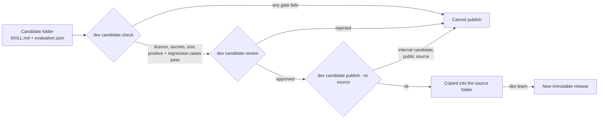

# Provenance & versioning

Every item in the trove can answer four questions: **where did this come from**, **has it changed**, **which
version is it**, and **can I get exactly that version again**. Dex Trove is capability *memory*: it remembers
every version it ever shipped, and a version, once released, never changes.

```mermaid
flowchart LR
  U[Upstream commit] -- dex learn --> T[Trove: current bytes<br/>content digest]
  T -- append --> L[(releases.json<br/>every version ever shipped)]
  L -- dex lock --> P[dex.lock.json<br/>version + digest]
  P -- dex install --locked --> I{Current digest?}
  I -- yes --> C[Copy from the trove]
  I -- no --> G[Fetch that commit from Git<br/>verify the digest]
  G -- match --> C2[Install]
  G -- mismatch --> X[Refuse: nothing written]
```

## Where it came from

Each item's `dex.json` records its source:

```json
"source": {
  "id": "awesome-copilot",
  "title": "Awesome GitHub Copilot",
  "repo": "https://github.com/github/awesome-copilot",
  "commit": "613efc8c21d9b3ce642dff361d17006cd9967e28",
  "path": "skills/git-commit",
  "url": "https://github.com/github/awesome-copilot/tree/613efc8c…/skills/git-commit",
  "author": null
}
```

- `commit` is the exact upstream commit the item was copied from, so the `url` is a permanent link.
- First-party items (from a local, non-git folder) have `commit: null`, and their `url` points into this
  repository's copy under `trove/`.
- `trove/trove.lock.json` records the commit for every source, so a `dex-trove` release is reproducible: the same
  version always contains the same items from the same commits.

Ananke receives the same information: the manifest's `metadata.homepage` is the pinned upstream URL,
`metadata.repository` is the repo, and `ananke_id` (`urn:dex-trove:<kind>:<ns>:<name>`) gives the item a stable
identity across versions.

## Has it changed?

Dex computes:

- `files`: every upstream file path in the item (generated files excluded).
- `entry_hash`: SHA-256 of the entry file, used for cross-source duplicate detection.
- `content_hash`: SHA-256 over the sorted `{path: sha256(bytes)}` map of all upstream files. This is the item's
  **digest**.

`dex validate` recomputes the digest for every item and fails on any mismatch, so hand edits under `trove/` are
caught in CI. Because upstream bytes are never modified, a re-learn diff shows exactly what changed upstream.

## Item versions

Each item has its own SemVer in `dex.json` and `ananke.yaml`:

| Situation | Version |
| --- | --- |
| First time learned | `1.0.0` |
| Re-learned, digest unchanged | unchanged (and `learned_at` unchanged, so diffs stay quiet) |
| Re-learned, content changed | patch bump: `1.0.0` → `1.0.1` |
| Upstream declares a version (e.g. `plugin.json` `"version": "2.1.0"`, or `version:` frontmatter) | the upstream version (normalised: `1.2` → `1.2.0`, `v3.0.1` → `3.0.1`) |
| Upstream changed the content but kept its declared version | the next free patch version (`2.1.0` → `2.1.1`): one version never means two contents |

## The release ledger

`trove/releases.json` records **every version of every item**, oldest first:

```json
"skill:superpowers/systematic-debugging": {
  "releases": [
    {
      "version": "1.0.0",
      "content_hash": "da4818601770…",
      "entry": "SKILL.md",
      "files": ["SKILL.md", "root-cause-tracing.md", "…"],
      "source": { "repo": "https://github.com/obra/superpowers", "commit": "bb92a7774141…", "path": "skills/systematic-debugging" },
      "released_at": "2026-10-20T04:06:53+00:00",
      "channel": "stable"
    }
  ]
}
```

- **Append-only.** `dex learn` adds a release when an item's digest changes. It never edits or deletes one.
- **Immutable.** After a release is written, only its `yanked` and `deprecated` markers may change.
  `dex validate --since <git-ref>` compares against the ledger at that ref and fails on any edit or deletion.
  CI runs it against the previous commit.
- **History outlives the item.** When an item leaves the trove (removed upstream, or newly excluded), its ledger
  entry is marked `removed` and kept, so existing locks can still fetch their pinned version.

See any item's history with `dex release list <ref>`.

## Locks: the same bytes, every time

A project lock pins items to an exact version **and** digest:

```bash
dex lock superpowers/systematic-debugging awesome-copilot/accessibility   # writes dex.lock.json
dex verify-lock                                                           # every pin exists with its digest
dex install --locked --target claude                                      # installs exactly what's pinned
```

- `dex lock <ref>` pins the newest stable, non-yanked release. Pin one explicitly with `<ref>@1.0.0` or
  `<ref>@sha256:<digest>`. A plugin pins each of its members.
- A refresh doesn't change what you've pinned. After `pip install -U dex-trove` brings v2 of an item, your lock
  still installs v1. Run `dex lock` again when you want v2.
- If the pinned version is the trove's current one, `dex install --locked` copies it from the trove. Otherwise it
  fetches **that release's upstream commit** from Git, recomputes the digest, and installs only on a match. This is
  a decentralised index: every release points at a public Git commit, so no hosted registry is needed.
- A mismatch, a missing commit or an unreachable repository is an error. Dex never falls back to another version
  or to a similarly named item.
- `dex verify-lock --fetch` also fetches and checks every pin that isn't current, so CI can prove a lock is still
  installable.

First-party items have no upstream commit (`commit: null`), so only their current release can be installed from
the trove. To get an older one, install the `dex-trove` version that shipped it.

## Yank, deprecate, fork

| Command | Effect | What happens to existing locks |
| --- | --- | --- |
| `dex release yank <ref>@<version> --reason …` | new locks skip this version | still install it, with a warning showing the reason |
| `dex release unyank <ref>@<version>` | reverses a yank | — |
| `dex release deprecate <ref> --reason … [--replaced-by <ref>]` | marks every release (or one, with `@version`) as deprecated | still install, with a warning naming the replacement |
| `dex release lineage <ref>` | shows what an item was forked from, and what was forked from it | — |

A **fork** is recorded, not hidden. Declare it in `sources.yaml` beside the item:

```yaml
items:
  alpha-plus:
    forked_from: skill:up/alpha          # or skill:up/alpha@1.0.0
```

The fork's releases then carry `parent: {key, version, content_hash}`. `dex validate` fails when a parent isn't
in the ledger, and the item pages show the lineage under **Related**.

### Security fixes to upstream items

Dex never edits an upstream item in place, because its digest has to keep matching upstream. When an item needs a fix:

1. Copy it to `forks/<name>/`, keep its licence file and add a `CHANGES.md` saying what changed.
2. Withhold the original in `sources.yaml` and declare the fork under the `patched` source with `forked_from`.
3. Deprecate the original with `--replaced-by`, so existing locks are told about the fork.

The fix should also go upstream. A fork keeps the original's name when other items refer to it by that name, unless the
upstream's trademark terms rule that out.

## Reviewed candidates: how new memory gets in

A harness such as Ananke may learn something worth keeping, such as a generalised fix strategy. That lesson becomes
a **candidate**, a skill folder with evidence beside it, and it enters a source only through an explicit, gated
publish:



```bash
dex candidate check ./fix-flaky-tests                   # skill, licence, secrets, evaluation
dex candidate review ./fix-flaky-tests --approve --reviewer "A. Lead" --reason "covers time and order flakes"
dex candidate publish ./fix-flaky-tests --to neo-pragnya
dex learn neo-pragnya                                   # records the new release
```

The gates:

1. `SKILL.md` with a lowercase-hyphen `name` and a real `description`, within the size limits.
2. A licence that is declared and allowed, and no secret-shaped text.
3. `evaluation.json` (`schema: dex-trove/evaluation@1`) with at least one `positive` and one `regression` case, all
   passing. A failed evaluation can't be published.
4. An approving `review.json`, written *after* the last change to the evaluation. Editing the evaluation means
   reviewing again.
5. `--visibility internal` candidates only publish to sources marked `visibility: internal` in `sources.yaml`.
   An internal lesson can't reach a public source.

`evaluation.json` and `review.json` stay beside the candidate as evidence. They are never published.

## Package versions

`dex-trove` itself follows SemVer, `0.x` while the format settles:

- **Patch**: trove refresh, fixes.
- **Minor**: new sources, new kinds, new CLI features, format additions.
- **Major** (after 1.0): incompatible changes to the item format or CLI.

Every release ships a fixed trove snapshot, including the full release ledger. `CHANGELOG.md` summarises trove
changes per release.
