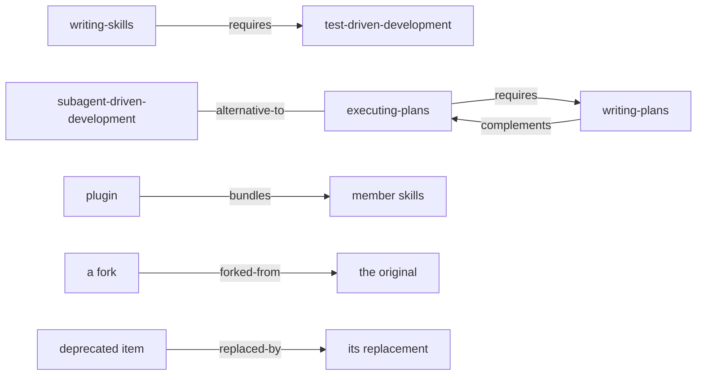

# Related items

Each item page has a **Related** section, and `dex related <ref>` prints the same. Every relation has a **type**, an
**origin** and **evidence**, so you can tell a reviewed fact from a guess.



## Types

| Type | Meaning | Origin | Shown on |
| --- | --- | --- | --- |
| `requires` / `required-by` | the source tells you to load or understand the target first | curated | both items |
| `complements` | different jobs that work well one after the other | curated | both items |
| `alternative-to` | the same job, done a different way: pick one | curated | both items |
| `part-of` / `bundles` | a plugin lists the item as a member | derived from `plugin.json` | both items |
| `forked-from` / `forked-as` | fork lineage | derived from the [release ledger](provenance-and-versioning.md#yank-deprecate-fork) | both items |
| `replaced-by` / `replaces` | the item is deprecated in favour of another | derived from the release ledger | both items |
| `similar` | shares tags or name words, which it names | **inferred** | the item |

- **Curated** relations live in `src/dex_trove/taxonomy/relations.yaml`. Each one needs `evidence` that a reader can
  check, usually a quote from the item's own text. On the site they carry a **reviewed** badge.
- **Derived** relations restate facts Dex already holds, so they can't drift.
- **Inferred** `similar` relations are a browsing hint. They're dropped when a typed relation already links the
  same two items.

## Never "compatible"

No relation type says two items are compatible, and none should be read that way:

- A skill that `requires` another means *read that one first*. It doesn't promise that either works with your
  framework, language or tools.
- Two `alternative-to` items may expect completely different setups.
- `similar` only means similar words.

Whether something will run in your setup depends on its declared requirements, its inputs and outputs, and the
tools you have. A harness such as [Ananke Plexus](https://neo-pragnya.github.io/Ananke-Plexus/) checks those when it
resolves and locks a capability. See also [Finding capabilities](../guides/finding-capabilities.md#what-facets-cant-tell-you).

## Checks

`dex validate` (and the release gate) fail when:

- a curated relation points at an item that isn't in the trove (no dangling references);
- a curated relation has an unknown type or no evidence, or relates an item to itself;
- `requires` relations form a cycle (nothing could be loaded first);
- `trove/relations.json` is stale: it's rebuilt by `dex learn` and `dex release record`.

## Adding a relation

Add an entry to `relations.yaml`:

```yaml
- { from: skill:superpowers/writing-skills, type: requires, to: skill:superpowers/test-driven-development,
    evidence: "writing-skills SKILL.md: 'REQUIRED BACKGROUND: You MUST understand superpowers:test-driven-development'" }
```

Then run `dex release record` (or `dex learn`) and `dex validate`. Symmetric types (`complements`,
`alternative-to`) and inverses (`required-by`) are added to the other item automatically.
