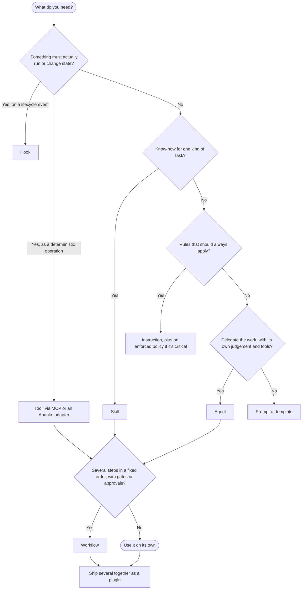

# Which artifact when

Dex Trove ships seven kinds of artifact. Their names overlap with everyday words ("workflow", "agent", "tool"), and
every AI tool uses them a little differently. This page fixes their meaning for Dex Trove and Ananke. The
distinction is always **behaviour and responsibility**, not branding.

**The short version.** A *skill* teaches how to do one kind of task. An *instruction* sets rules that always apply.
An *agent* is someone you hand the work to. A *workflow* is a run with fixed steps and gates. A *hook* fires on an
event. A *plugin* is a box that ships several of these together. A *tool* actually does something; Dex describes
when to use tools but doesn't ship them.

| Kind | It is… | Loaded when… | It decides? | It executes? | In the trove |
| --- | --- | --- | --- | --- | --- |
| **Skill** | A procedure or body of know-how for one kind of task | The task matches its description | No: it guides whoever is working | Only if it bundles scripts the agent chooses to run | 468 |
| **Instruction** | Standing guidance: style, conventions, rules | Always, or for files matching `applyTo` | No | No | 189 |
| **Agent** | A persona with an objective, a tool scope and maybe a model | You (or a host) delegate to it | Yes, within its scope | Through the tools it's allowed | 220 |
| **Prompt** | A reusable invocation (slash command, prompt file) | You run it | No: it starts work | No | 0 |
| **Workflow** | Steps in a fixed order with triggers, gates and outputs | A trigger fires (schedule, event, command) | The plan is fixed; steps may use agents | Yes: it's a run | 8 |
| **Hook** | A handler bound to a host lifecycle event | The event happens (before a tool call, at session end) | No | Yes, usually a script | 7 |
| **Plugin** | A distributable bundle of other artifacts | You install it | No | No: its members do | 72 |

Two kinds you'll meet in Ananke are not shipped by Dex Trove. A **tool** is an executable operation with typed
arguments and output, such as an MCP tool, a CLI or an Ananke adapter. A **policy** is a rule the harness *enforces*,
whereas an instruction only *asks* for something.

## Choose in four questions



## The ten pairs people mix up

### 1. Skill vs agent

A **skill** is *knowledge*: how to do something well. An **agent** is an *actor*: someone you hand a job to. A skill
has no objective of its own. It waits until the current task matches its description, and then guides whoever is
working, whether that's the main session or an agent. An agent has an objective and a scope of tools, and makes its
own decisions inside that scope.

- **Choose a skill** when you want a repeatable approach applied wherever the task comes up, in any session.
- **Choose an agent** when you want a separate worker with its own instructions, tool limits and context. That suits
  long or specialised jobs you'd rather not mix into the main conversation.
- **In the trove:** [`superpowers/test-driven-development`](https://neo-pragnya.github.io/Dex-Trove/skill/superpowers.test-driven-development/) is a
  skill: it makes *whoever is coding* work test-first. [`awesome-copilot/tdd-red`](https://neo-pragnya.github.io/Dex-Trove/agent/awesome-copilot.tdd-red/),
  `tdd-green` and `tdd-refactor` are agents: each does one phase of the cycle.
- **Common mistake:** writing an "agent" that is really a checklist. If it has no distinct tool scope or objective,
  it's a skill.

### 2. Skill vs instruction

Both are guidance; the difference is **when** they apply. An **instruction** is always on, for everything or for
files matching its `applyTo` glob, so it costs context in every request. A **skill** is loaded only when a task
matches, so it can be long and detailed.

- **Choose an instruction** for short, universal rules: naming, style, "always use the logger, never `print`".
- **Choose a skill** for a procedure that matters only for some tasks: how to write a migration, how to debug flaky
  tests.
- **In the trove:** [`awesome-copilot/playwright-python`](https://neo-pragnya.github.io/Dex-Trove/instruction/awesome-copilot.playwright-python/) is an
  instruction that applies whenever Copilot edits Python test files.
  [`awesome-copilot/playwright-generate-test`](https://neo-pragnya.github.io/Dex-Trove/skill/awesome-copilot.playwright-generate-test/) is a skill you
  reach for when you're writing a new test from a scenario.
- **Common mistake:** putting a 300-line procedure in an instruction. It slows down every request, including ones
  that have nothing to do with it.

### 3. Workflow vs skill

A **skill** helps with *one* task. A **workflow** is a *run*: several steps in a set order, started by a trigger,
with inputs, outputs and often a gate or approval between steps.

- **Choose a skill** when a person or agent is doing the work and needs to know how.
- **Choose a workflow** when the steps must happen in a governed order and you want the result to be repeatable and
  auditable.
- **In the trove:** today the workflow kind is GitHub Agentic Workflows: Markdown that runs an agent in GitHub
  Actions on a schedule or event. For example, [`awesome-copilot/daily-issues-report`](https://neo-pragnya.github.io/Dex-Trove/workflow/awesome-copilot.daily-issues-report/)
  posts a summary every day. In Ananke, a workflow is a typed, multi-step plan that Ananke compiles, runs and
  records evidence for.
- **Common mistake:** a skill that says "first do A, then B, then wait for approval". If order and approvals are
  required rather than suggested, the harness should enforce them, so it's a workflow.

### 4. Workflow vs agent

A **workflow** fixes *what happens and in which order*. An **agent** decides *what to do next*. They combine: a
workflow step can hand a bounded job to an agent.

- **Choose a workflow** when repeatability and audit matter more than flexibility.
- **Choose an agent** when the path isn't known in advance and judgement is the point: triage, investigation,
  review.
- **Common mistake:** calling a free-roaming agent a "workflow" because it usually does the same steps. If nothing
  enforces the order, it's an agent.

### 5. Tool vs skill

A **tool** *does* something: it runs a query, calls an API or writes a file, with structured arguments and output.
A **skill** says *when and how* to use tools. A skill can bundle scripts, but the agent decides whether to run them;
the skill itself never executes.

- **Choose a tool** for deterministic computation or side effects you want to happen exactly.
- **Choose a skill** for the judgement around it: which tool, in what order, and how to read the result.
- **In the trove:** the Playwright skills above use the Playwright MCP server's tools. The server is the tool; the
  skill is the method.

### 6. Tool vs plugin

A **tool** is one callable operation. A **plugin** is a *package*: an installable set of artifacts (skills, agents,
instructions, sometimes MCP configuration) that belong together.

- **Choose a tool** when you need one operation.
- **Choose a plugin** when you want to install a whole capability at once and keep its parts in step.
- **In the trove:** [`awesome-copilot/testing-automation`](https://neo-pragnya.github.io/Dex-Trove/plugin/awesome-copilot.testing-automation/) bundles
  testing skills (NUnit, JUnit, Playwright) and the `playwright-tester` agent. `dex install` expands a plugin into
  its members.

### 7. Plugin vs workflow

A **plugin** is a *packaging* boundary: what gets installed and versioned together. A **workflow** is an *execution*
boundary: what runs, in which order. A plugin doesn't run anything by itself, and a workflow doesn't decide what you
install.

- **Choose a plugin** to distribute and manage a set of members.
- **Choose a workflow** to coordinate steps.
- In Ananke, a plugin becomes a **bundle**: a resolved group of versioned references.

### 8. Agent vs subagent

An **agent** owns its task and policy scope. A **subagent** is an agent that a parent session *delegates to* for a
bounded step, then returns from. In Claude Code, every installed agent can act as a subagent: the main session
chooses it from its `description`.

- **Choose a top-level agent** when the agent owns the whole job and talks to you directly.
- **Choose a subagent** for a specialised step inside a bigger task, with its own context so the parent stays focused.
- **Dex installs agents for both.** For Claude Code, `dex install` translates Copilot-style `tools` and `model` values
  into ones Claude Code can launch: see [Installing items](../guides/installing-items.md).

### 9. Hook vs workflow

A **hook** reacts to *one event in the host's lifecycle*, such as before a tool call or when a session ends, and
usually runs a script. A **workflow** is a *planned sequence* with dependencies between steps.

- **Choose a hook** when something must happen every time an event occurs: block a dangerous command, log a session.
- **Choose a workflow** when several steps and their order need governing.
- **In the trove:** [`awesome-copilot/tool-guardian`](https://neo-pragnya.github.io/Dex-Trove/hook/awesome-copilot.tool-guardian/) is a hook that blocks
  destructive operations before Copilot runs them. Because hooks run code, `dex install` asks for `--allow-exec`.

### 10. Template vs skill

A **template** is a *fixed shape* to copy: a scaffold, config file or document outline. A **skill** is *know-how
that adapts* to the situation.

- **Choose a template** when the output must look the same every time.
- **Choose a skill** when the agent has to adapt: choose sections, ask questions, make trade-offs.
- Skills often ship templates in `assets/`. The skill decides how to fill them in.

## More distinctions worth knowing

- **Prompt vs instruction.** A prompt starts a piece of work; an instruction shapes all work. A prompt alone
  guarantees nothing about how the work is done or checked.
- **Policy vs instruction.** "Never push to `main`" as an instruction is a request. As an Ananke policy, it's enforced.
  Anything critical needs the policy.
- **Evaluator vs test.** A test asserts a deterministic contract (exit code, output, schema). An evaluator scores
  qualitative output (relevance, faithfulness). Both can be workflow steps.
- **MCP server vs MCP tool.** The server is a process that exposes tools and resources; a tool is one operation on
  it. Installing a server doesn't grant an agent permission to use its tools.
- **Pipeline vs workflow.** A pipeline usually moves data through stages. A workflow adds coordination: triggers,
  approvals, retries and lifecycle state. When Ananke executes either, both become a typed plan.
- **Plugin vs bundle.** A Dex *plugin* is a distributable set of members. An Ananke *bundle* is a resolved set of
  exact versions. Installing a plugin into Ananke creates the bundle.
- **SDLC vs ADLC.** These are *methodologies*, not artifacts. One skill can serve both. ADLC (Agent Development
  Life Cycle, as Ananke uses it) builds software with agents and humans, driven by specs, policies, explicit context
  assembly and execution evidence. It overlaps SDLC but isn't another name for it, so Dex keeps them as separate
  facet values.

## Worked example: adding browser tests to a Python web app

Find each piece by what it does, not by its name:

```bash
dex search --task write-tests --framework playwright --explain
```

| You need… | Kind | From the trove |
| --- | --- | --- |
| Conventions applied to every test file Copilot touches | instruction | `awesome-copilot/playwright-python` |
| A procedure for turning a scenario into a test | skill | `awesome-copilot/playwright-generate-test` |
| A specialist to delegate a test suite to | agent | `awesome-copilot/playwright-tester` |
| The method for test-first work | skill | `superpowers/test-driven-development` |
| Everything above in one install | plugin | `awesome-copilot/testing-automation` |
| The browser automation itself | tool | Playwright (MCP server or library), not in Dex |
| Tests run and proven before merge | workflow | An Ananke workflow or your CI, with evidence |

The skill, instruction and agent *guide* the work. Playwright *does* it. Ananke or CI *proves* it.

## How each tool uses these kinds

| Kind | Claude Code | GitHub Copilot | Ananke |
| --- | --- | --- | --- |
| Skill | `.claude/skills/<name>/` | `.github/skills/<name>/` | `skill` |
| Instruction | — (use `CLAUDE.md`) | `.github/instructions/*.instructions.md` | `prompt` |
| Agent | `.claude/agents/<name>.md` | `.github/agents/<name>.agent.md` | `agent` |
| Prompt | `.claude/commands/<name>.md` | `.github/prompts/` | `prompt` |
| Workflow | — | `.github/workflows/<name>.md` (agentic workflows) | `workflow` |
| Hook | — | `.github/hooks/<name>/` | `tool` |
| Plugin | its members | its members | `bundle` |

"—" means there is no native place for it; `dex install --target dir` copies the item so you can wire it up yourself.
More detail on each kind: [Artifact kinds](artifact-kinds.md). Finding items by what they're for:
[Finding capabilities](../guides/finding-capabilities.md).
