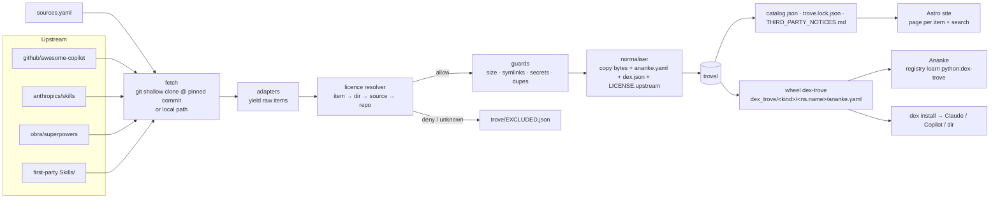
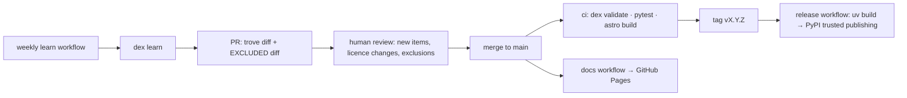

# Dex Trove — Design

| | |
| --- | --- |
| Status | v0.1 implemented, pre-release (see [CHECKLIST.md](CHECKLIST.md)) |
| Owner | Neo Pragnya |
| Date | 2026-10-19 |
| Package | `dex-trove` on PyPI · import `dex_trove` · CLI `dex` |
| Related | [Ananke Plexus](https://github.com/Neo-Pragnya) (harness), [github/awesome-copilot](https://github.com/github/awesome-copilot) (primary inspiration) |

## 1. Problem

Ananke is the harness layer: registry, resolution, activation, policy and evidence for skills, agents and tools. It has
no *library* of ready-made artifacts to put in that registry. Meanwhile, good artifacts are scattered across community
repos (awesome-copilot, anthropics/skills, obra/superpowers, …) and our own work (architecture-as-code, animated SVG
diagrams, course and ikigai builders). Each source uses its own layout and licence conventions, and many redistribute
material they do not own.

Dex Trove is that library. It:

1. **Learns** artifacts from mapped upstream repos and from first-party skills.
2. **Admits** only content whose licence allows redistribution and reuse, item by item, with evidence.
3. **Standardises** each item into one canonical layout that Ananke can register with no custom code.
4. **Ships** the result as a Python package (`pip install dex-trove`, CLI `dex`).
5. **Documents** every item on its own page in an Astro site with search, crediting each upstream source.

## 2. Goals and non-goals

### Goals

* G1. One canonical, versioned layout for skill, agent, instruction, prompt, hook, workflow and plugin (bundle) items.
* G2. Per-item licence resolution with an allow-list (MIT, Apache-2.0, BSD, ISC, CC0, …). Unknown means excluded.
* G3. Provenance on every item: source repo, pinned commit, upstream path, upstream URL, licence evidence, content hash.
* G4. Zero-glue Ananke integration: an installed wheel is learnable with `ananke registry learn python:dex-trove`.
* G5. Installs straight into Claude Code, GitHub Copilot or any directory, for people who don't use Ananke.
* G6. A static docs site with one page per item, client-side search and a Sources & Inspirations page.
* G7. A repeatable `learn → review PR → merge → release to PyPI` loop.

### Non-goals (v0.x)

* Running or evaluating artifacts. Ananke owns execution, gates and evals.
* Rewriting upstream content. Items are copied byte-for-byte; Dex only *adds* files next to them.
* A hosted registry server. Ananke's `registry serve` and remote federation already do that.
* Canvas extensions and cookbook recipes from awesome-copilot. Those are JS apps, not agent artifacts.

## 3. Concepts

| Term | Meaning |
| --- | --- |
| **Source** | An upstream repo or local folder mapped in `sources.yaml`, with an adapter and licence expectations |
| **Adapter** | Code that knows a source's layout and yields raw items (`agent-skills`, `awesome-copilot`, `md-agents`) |
| **Item** | One artifact: a directory in `trove/<kind-plural>/<namespace>.<name>/` |
| **Namespace** | The source id (e.g. `awesome-copilot`, `anthropic`, `neo-pragnya`). Prevents name clashes |
| **Trove** | The checked-in, normalised library (`trove/`), plus `catalog.json` and `trove.lock.json` |
| **Verdict** | Licence decision per item: `allow`, `review` (excluded unless the source opts in) or `deny` |

## 4. Architecture



### 4.1 Repository layout

```text
Dex-Trove/
├── sources.yaml              mapped sources (adapter, roots, licence expectations, enabled)
├── trove/                    THE LIBRARY (checked in, reviewed in PRs)
│   ├── skills/<ns>.<name>/   SKILL.md + bundled files (verbatim) + ananke.yaml + dex.json [+ LICENSE.upstream]
│   ├── agents/ instructions/ prompts/ hooks/ workflows/ plugins/
│   ├── catalog.json          index of every item (drives CLI search + docs site)
│   ├── EXCLUDED.json         every rejected item with its reason (licence, secret, size, duplicate)
│   └── trove.lock.json       source → commit learned, timestamp, counts
├── THIRD_PARTY_NOTICES.md    generated attribution (copyright lines + licence per source/item)
├── src/dex_trove/            the `dex` package
├── website/                  Astro docs site (content generated from trove/ at build time)
├── docs/design/              this document + checklist
└── .github/workflows/        ci · docs (Pages) · release (PyPI) · learn (scheduled PR)
```

### 4.2 Canonical item layout

```text
trove/skills/awesome-copilot.git-commit/
├── SKILL.md              ← upstream, unmodified
├── scripts/…             ← upstream, unmodified
├── LICENSE.upstream      ← governing licence text, only when the item didn't ship one
├── ananke.yaml           ← generated Ananke manifest (strict schema)
└── dex.json              ← generated provenance + catalog record
```

Upstream bytes are never modified. That keeps copyright notices intact, makes re-learn diffs honest and lets
`dex.json.files` hashes prove nothing drifted.

**Why `<namespace>.<name>` flat directories:** Ananke's Python importer only looks for manifests at most four path
parts deep inside a wheel (`dex_trove/skills/<ns.name>/ananke.yaml`). A nested `<ns>/<name>` would be invisible to it.
The flat form also mirrors Ananke's own installed layout (`<namespace>.<name>@<version>`).

### 4.3 Kind mapping

| Dex kind | Upstream shape | Ananke `kind` | Claude Code install | Copilot install |
| --- | --- | --- | --- | --- |
| skill | dir with `SKILL.md` | `skill` | `~/.claude/skills/<name>/` | `.github/skills/<name>/` |
| agent | `*.agent.md` / frontmatter `.md` | `agent` | `~/.claude/agents/<name>.md` | `.github/agents/<name>.agent.md` |
| instruction | `*.instructions.md` (`applyTo`) | `prompt` (tag `instruction`) | appended reference in `CLAUDE.md` (manual) | `.github/instructions/` |
| prompt | `*.prompt.md` | `prompt` | `~/.claude/commands/<name>.md` | `.github/prompts/` |
| hook | dir with `hooks.json` | `tool` (tag `hook`, `executes-code`) | dir copy only (`--allow-exec`) | `.github/hooks/<name>/` (`--allow-exec`) |
| workflow | agentic workflow `.md` | `workflow` | n/a | `.github/workflows/<name>.md` |
| plugin | `plugin.json` with members | `bundle` (`members` = `ananke://…` URIs) | members installed individually | members installed individually |

## 5. Licence policy

Redistribution through PyPI is *distribution*, so only content we may copy and share goes in.

| Verdict | SPDX ids | Behaviour |
| --- | --- | --- |
| **allow** | MIT, MIT-0, Apache-2.0, BSD-2-Clause, BSD-3-Clause, ISC, 0BSD, Unlicense, CC0-1.0, CC-BY-4.0, Zlib, BSL-1.0, Python-2.0, PSF-2.0 | Imported; notices preserved |
| **review** | MPL-2.0, EPL-2.0, LGPL-*, CC-BY-SA-* | Excluded unless the source sets `allow_review: true` after a human decision |
| **deny** | GPL-*, AGPL-*, CC-BY-NC*, CC-BY-ND*, SSPL, BUSL, proprietary/source-available, `NOASSERTION`, unknown | Never imported; recorded in `EXCLUDED.json` |

**Resolution order (most specific wins):**

1. Item frontmatter `license:` when it is a valid SPDX expression. If it points at a file ("Complete terms in
   LICENSE.txt"), go to step 2.
2. A licence file in the item directory (`LICENSE*`, `COPYING*`), classified by **text**, not filename.
3. A licence file in an ancestor directory inside the source (e.g. `src/fetch/LICENSE`).
4. The source's repo-root licence, classified by text.
5. `sources.yaml` `license.default`, allowed **only** for `first_party: true` sources we own.

Text classification uses normalised-text fingerprints for the common licences, plus explicit *deny markers* such as
"All rights reserved" without a grant, "governed by your agreement with", or "may not … redistribute". A deny marker
beats an allow fingerprint.

**Why per-item and by text:** this is not hypothetical. On 2026-10-19:

* `anthropics/skills` has no repo licence; its example skills ship Apache-2.0 `LICENSE.txt` files, while
  `docx`, `pdf`, `pptx` and `xlsx` ship proprietary, source-available terms.
* `ComposioHQ/awesome-claude-skills` redistributes those same proprietary document skills.
* Three awesome-copilot skills say `license: Complete terms in LICENSE.txt`.

SPDX expressions with `OR` pass if any branch is allowed. With `AND`, every branch must be allowed.

**Nested licences.** Licence files *inside* an item, such as bundled fonts or vendored code, are classified too.
Any denied one excludes the whole item. Allowed ones are recorded as `license.components`; for example, the OFL-1.1
fonts in `anthropic/canvas-design`. Only strict licence filenames count (`LICENSE*`, `COPYING*`, `*-OFL.txt`).
A reference doc that merely *describes* a licence, such as `pdftk-server/references/pdftk-server-license.md`, is
content, not terms.

**Declared but not shipped.** When an item declares Apache-2.0 in frontmatter but no Apache text exists upstream
(7 awesome-copilot items), Dex writes the canonical text from `dex_trove/license_texts/` as `LICENSE.upstream`,
because Apache §4(a) requires recipients to receive a copy.

**Attribution:** MIT, BSD and Apache require the copyright and licence notice to travel with the copy. Each item keeps
its own licence file, or gets `LICENSE.upstream`. Apache `NOTICE` files are copied too. `THIRD_PARTY_NOTICES.md`
aggregates everything and ships in the sdist and wheel.

**Third-party assets inside first-party skills:** `marvellous-aws-architecture-docs/assets/icons/*` are AWS
Architecture Icons. AWS grants use *in diagrams*, not redistribution as an icon set. Dex excludes that folder via
`sources.yaml` `exclude:` globs. The skill's own `scripts/fetch_icons.py` pulls them on demand from the MIT-licensed
`diagrams` wheel, and `archlib` falls back to text boxes until then.

## 6. Guards (beyond licence)

| Guard | Rule | On failure |
| --- | --- | --- |
| Size | file ≤ 5 MB, item ≤ 20 MB | exclude (`size`) |
| Symlinks / traversal | no symlinks; no `..`; paths stay inside the item | skip file and record a note |
| Junk | `.DS_Store`, `__pycache__`, `*.pyc`, `.git*`, `node_modules` | skipped silently |
| Secrets | AWS keys, private keys, GitHub/Slack/OpenAI/Anthropic token patterns | exclude (`secret`) |
| Executable content | `.sh .ps1 .py .js .mjs .ts` or `hooks.json` present | tag `executes-code`; hooks need `--allow-exec` to install |
| Duplicates | same normalised entry-file hash as an item from a higher-priority source | exclude (`duplicate-of`) |
| Name | Ananke `_NAME_RE` (lower-kebab, ≤ 64) after slugify | slugify; collision means exclude |
| Private items | `.dexignore` in the source root, or `~/.config/dex-trove/ignore` (`[source:]pattern`) | skipped silently: not copied, not in `EXCLUDED.json` or the lock |

| Ananke secret rules | Dex mirrors Ananke's registration-time scanner (broader than Dex's own) | keep, but record `secret_flags` and tag `ananke-secret-flag`; `dex ananke sync` skips unless `--include-flagged` |

The two secret scanners have different jobs. Dex's own patterns target *real* key formats and exclude on a hit.
Ananke's are broader (e.g. `api_key = "<16+ chars>"`) and, on the first full run, refused 9 security-teaching items
for placeholders like `"PINECONE_API_KEY"` and `sk_live_…`. Dropping those items from the library would
lose good content. Shipping them silently would make `ananke registry learn python:dex-trove` exit non-zero. Flagging
them keeps both behaviours honest.

Upstream content stays **untrusted**. Dex never executes it, and the docs site renders it through `rehype-sanitize`.

## 7. Versioning

* **Package**: SemVer, `0.x` while the format settles. Every release bumps the version, even when only content changed.
* **Items**: each item carries its own SemVer in `ananke.yaml`. First learn gives `1.0.0`; if a re-learn changes the
  content hash, the patch is bumped; an upstream-declared version (e.g. `plugin.json.version`) wins when present.
  So `ananke registry learn` registers a new immutable version only when content actually changed.
* **Sources**: `trove.lock.json` pins the commit each source was learned at. A release is fully reproducible.

## 8. CLI (`dex`)

| Command | Purpose |
| --- | --- |
| `dex sources [--json]` | Mapped sources, adapters, expected licence, enabled flag |
| `dex learn [SOURCE…] [--dry-run] [--refresh]` | Fetch → adapt → licence → guard → normalise → write trove, lock, catalog, notices |
| `dex validate` | CI gate: manifests parse against Ananke's rules, licences allowed, hashes match, notices current |
| `dex list [--kind] [--source]` / `dex search QUERY` / `dex show REF` | Browse the catalog (works offline from the wheel) |
| `dex install REF… --target claude\|copilot\|dir [--path P] [--scope user\|project] [--allow-exec]` | Copy items into a tool's native layout |
| `dex license PATH` | Classify a licence file or directory and print the verdict and evidence |
| `dex ananke sync [--project P] [--kind K] [--source S] [--dry-run]` | Register trove items into an Ananke registry |
| `dex notices` | Regenerate `THIRD_PARTY_NOTICES.md` |
| `dex docs export --out DIR` | Write Astro content (one Markdown file per item plus JSON indexes) |

`REF` is `namespace/name`, `kind:namespace/name` or a unique bare `name`.

## 9. Ananke integration

**Works today, with no Ananke change:**

```bash
pip install ananke-plexus dex-trove
ananke registry init
ananke registry learn python:dex-trove     # every item's ananke.yaml is discovered inside the wheel
# or selectively, through Dex:
dex ananke sync --kind skill --source neo-pragnya
```

Each manifest sets `license`, `metadata.repository`, tags and `ananke_id: urn:dex-trove:<kind>:<ns>:<name>`, so
Ananke's registry keeps identity stable across versions. Ananke's own licence policy (`[licenses] allow`) applies on
top of Dex's. That's defence in depth.

**Proposed Ananke change (the "special setting"), tracked separately:**

1. `pip install "ananke-plexus[dex]"` extra, which pulls `dex-trove`.
2. Policy setting:

   ```toml
   # .ananke/registry/policy.toml
   [troves]
   dex-trove = { enabled = true, kinds = ["skill", "agent"], sources = ["*"], channel = "candidate" }
   ```

   `ananke registry init` and `ananke sync` then auto-learn `python:dex-trove` when it is installed and enabled, and
   re-learn when the installed `dex-trove` version changes.
3. Dex exposes an entry point `ananke.troves: dex-trove = dex_trove.ananke_bridge:trove_root` so Ananke can find
   any trove package generically, not just Dex.

**Shipped in Ananke 0.3.7:** `ananke registry troves list|enable|sync` with `[troves.dex-trove]` in
`.ananke/config.toml`, discovered through the `ananke.troves` entry point.

## 10. Docs site

Astro (same stack as VICHARA), static, deployed to GitHub Pages.

| Route | Content |
| --- | --- |
| `/` | What Dex is, counts per kind, install and Ananke quickstart |
| `/catalog/` | All items; client-side search (name, description, tags) with kind, source and licence filters |
| `/<kind>/<ns.name>/` | Per-item page: description, kind, licence verdict and evidence, **source / inspiration** (repo, commit, upstream path link, author), install commands (`dex`, Ananke, manual), file list, rendered upstream Markdown (sanitised) |
| `/sources/` | Sources & Inspirations: every mapped repo, licence, item counts, and candidates that were evaluated and **not** imported, with the reason |
| `/excluded/` | What was rejected and why (licence, secret, duplicate) — the governance trail |
| `/design/` | This document |

Content is generated at build time by `dex docs export`, so the site can't drift from the trove. The export rewrites
relative image and link targets in upstream Markdown to the upstream repo, **pinned to the learned commit**:
`raw.githubusercontent.com` for images and `github.com/…/blob/<commit>/` for links. Otherwise they would 404 on the
site, and Astro would try to bundle them as local assets and fail the build.

**Markdown pipeline:** `remark-doc-links`, then `remark-callouts`, then `remark-mermaid`, then Shiki, then
`rehype-class-names`, then `rehype-sanitize`. Upstream Markdown is untrusted, so the sanitiser always runs last. Three
things are allowed through:

- heading ids (for the table of contents);
- callout classes;
- Shiki's highlighting, with inline styles limited to colour custom properties and a few keywords (no `url()`).

Mermaid fences are marked at build time (`pre.mermaid-src`), so the browser renders exactly those. A Markdown code
sample that merely *contains* a Mermaid fence stays a code sample.

**Motion:** `motion-kit` (from `interactive-web-motion`) drives the glyphs, the hero field, the particle headline,
the rotating word and the letter waves. `diagram-fx` (from `living-diagrams`) makes rendered Mermaid diagrams respond
to hover. Both respect *reduce motion* and `?motion=static`.

**Acceptance:** before every release, `acceptance/` runs Gherkin scenarios against the built wheel and the browser
journeys run against the built site. A release gate turns them into PROMOTE, CONDITIONAL or BLOCK. See
`acceptance/README.md`.

## 11. Delivery loop



A licence that *changes* upstream (e.g. MIT → proprietary) makes the item disappear from the next learn and show up
in `EXCLUDED.json`. The PR diff makes that visible to a reviewer.

## 12. Source map

Licences were verified through the GitHub API on 2026-10-19. "Repo" is the repo-level licence; items are still
resolved one by one.

| Source | Repo licence | What it offers | Decision |
| --- | --- | --- | --- |
| `github/awesome-copilot` | MIT | 435 skills, 222 agents, 192 instructions, hooks, workflows, 104 plugins | **Enabled** (adapter `awesome-copilot`) |
| first-party `Skills/` (Neo Pragnya) | MIT (Dex-Trove licence; we are the authors) | architecture-as-code + animated SVG, Astro docs sites, interactive web motion, life-ikigai-architect | **Enabled** (`first_party`, AWS icons excluded) |
| `anthropics/skills` | none — per item | Apache-2.0 example skills; proprietary document skills | **Enabled**: per-item; docx/pdf/pptx/xlsx denied |
| `obra/superpowers` | MIT | engineering-workflow skills (TDD, debugging, planning) | **Enabled** |
| `huggingface/skills` | Apache-2.0 | ML / HF Hub skills | Mapped, enable next |
| `K-Dense-AI/claude-scientific-skills` | MIT | large scientific skill set | Mapped, enable next (size review) |
| `wshobson/agents` | MIT | Claude Code subagents and plugins | Mapped, needs `md-agents` tuning |
| `VoltAgent/awesome-claude-code-subagents` | MIT | categorised subagents | Mapped, needs `md-agents` tuning |
| `davila7/claude-code-templates` | MIT | agents, commands, hooks, MCP configs | Mapped, later |
| `microsoft/skills` | MIT | Microsoft-authored skills | Mapped, enable next |
| `anthropics/claude-plugins-official` | Apache-2.0 | official Claude Code plugins | Mapped, later (plugin adapter) |
| `PatrickJS/awesome-cursorrules` | CC0-1.0 | Cursor rules → `instruction` | Mapped, later (`rules` adapter) |
| `openai/skills` | none — per item | curated Codex skills with per-item `LICENSE.txt` | Mapped, per-item only |
| `ComposioHQ/awesome-claude-skills` | none — per item | mix incl. **redistributed proprietary Anthropic skills** | Per-item only; dedupe prefers `anthropic` |
| `vercel-labs/agent-skills` | none, no item licences found | — | **Not importable** until licensed |
| `f/awesome-chatgpt-prompts` | NOASSERTION (dual CC0/MIT files) | prompts | Later; needs manual verdict |
| `modelcontextprotocol/servers` | NOASSERTION, per-server licences | MCP servers (code) | Out of scope: these are runnable servers, referenced not copied |
| `trailofbits/skills` | CC-BY-SA-4.0 | security skills | `review`: share-alike; needs a decision |
| `hesreallyhim/awesome-claude-code`, `punkpeye/awesome-mcp-servers` | link lists | — | Use as **discovery** inputs, not content |

## 13. Risks and open questions

| Risk / question | Mitigation / proposal |
| --- | --- |
| Upstream mislabels licences | Text classification + deny markers; human review on every learn PR |
| Wheel size grows past PyPI limits (100 MB) | Today about 25 MB uncompressed. Watch in CI; split into `dex-trove-<source>` extras if needed |
| Name collisions within a namespace | Slug + collision exclusion; recorded in `EXCLUDED.json` |
| Item SemVer churn on cosmetic upstream edits | Hash only content files, not Dex-generated ones |
| Bundles whose members got excluded | Members are dropped with a note; a bundle with no members is excluded |
| Should CC-BY-SA content ever be admitted? | Open. Proposal: allow per source when the content is self-contained text, and keep it out of Dex-authored derivatives |
| Should `dex` push into Ananke directly via its Python API instead of the CLI? | Start with the CLI (stable contract). Revisit once the `[troves]` setting lands |
| First-party skills live in a local, non-git `Skills/` folder, so CI can't re-learn them | Today the checked-in `trove/skills/neo-pragnya.*` copy is the record, re-learned locally. Proposal: move first-party sources into this repo (`first-party/`) or their own git repo |
| Ananke's generic-credential rule flags placeholders | Propose a placeholder-aware rule or a per-artifact allow-list in Ananke; until then Dex flags (see §6) |
