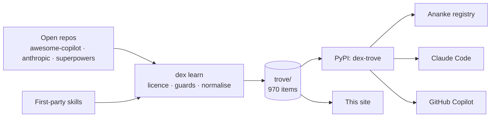

# Dex Trove documentation

Dex Trove is a **licence-clean library of agent artifacts**: skills, agents, instructions, prompts, hooks,
agentic workflows and plugins. It *learns* them from open repositories, admits only what may legally be
redistributed, normalises each one into a standard folder with full provenance, and ships the result as a Python
package (`pip install dex-trove`, CLI `dex`).

It is the content layer for [Ananke Plexus](https://github.com/Neo-Pragnya/Ananke-Plexus). Ananke is the
harness: registry, resolution, policy, activation and evidence. Dex Trove is the library you load into it. Dex
also installs straight into Claude Code and GitHub Copilot, so you don't need Ananke to use it.

## Start here

| If you want to… | Read |
| --- | --- |
| Install the package and use your first skill | [Getting started](guides/getting-started.md) |
| Put items into Claude Code, Copilot or a folder | [Installing items](guides/installing-items.md) |
| Load the library into Ananke | [Ananke integration](guides/ananke-integration.md) |
| Understand why an item is (or isn't) in the trove | [Licence policy](concepts/licence-policy.md) |
| Learn from a new repository | [Adding a source](guides/adding-a-source.md) |
| Look up a command or file format | [CLI reference](reference/cli.md) · [Item format](reference/item-format.md) |

## Concepts

- [Why Dex Trove](concepts/why-dex-trove.md): the problem, and the principles that shape the solution.
- [Architecture](concepts/architecture.md): the learn pipeline, the trove, the package and the site.
- [Artifact kinds](concepts/artifact-kinds.md): skills, agents, instructions, prompts, hooks, workflows and
  plugins, and how each tool consumes them.
- [Licence policy](concepts/licence-policy.md): allow/review/deny, resolution order, attribution.
- [Provenance & versioning](concepts/provenance-and-versioning.md): pinned commits, content hashes, item SemVer.
- [Security model](concepts/security-model.md): untrusted content, guards, secret flags, scanning.

## Guides

- [Getting started](guides/getting-started.md)
- [Installing items](guides/installing-items.md)
- [Ananke integration](guides/ananke-integration.md)
- [Adding a source](guides/adding-a-source.md)
- [First-party skills](guides/first-party-skills.md)
- [Docs site](guides/docs-site.md)
- [Release](guides/release.md)

## Reference

- [CLI](reference/cli.md)
- [`sources.yaml`](reference/sources-yaml.md)
- [Item format (`dex.json`, `ananke.yaml`)](reference/item-format.md)
- [Trove files (catalog, lock, exclusions, notices)](reference/trove-files.md)
- [Licence identification](reference/licence-identification.md)
- [Exclusion reasons](reference/exclusion-reasons.md)
- [Configuration & environment](reference/configuration.md)
- [Python API](reference/python-api.md)

## Design

- [Design document](design/DESIGN.md)
- [Implementation checklist](design/CHECKLIST.md)
